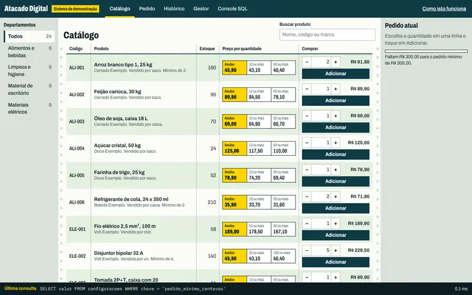

# Atacado Digital



**Ver funcionando:** https://toshiro01001.github.io/Atacado_Digital_Brasileiro/

## O que é este site

Fiz uma loja de atacado de demonstração: daquelas em que uma empresa compra de outra em grande quantidade, com preço que cai conforme a quantidade aumenta. Ela mostra, de ponta a ponta, o que um sistema desses faz: catálogo por departamento, carrinho, pedido mínimo, fechamento do pedido com baixa no estoque e um painel para quem administra a loja.

**Todos os dados são fictícios** (empresas, marcas, pessoas, documentos e preços) e nada é vendido nem cobrado de verdade. É um exemplo do tipo de sistema que a Mil e Uma Linhas! faz para empresas.

## Como usar

1. Abra o link acima. A loja carrega sozinha, sem cadastro nem senha.
2. No **Catálogo**, mude a quantidade de um produto com os botões − e + e veja o preço de cada unidade cair por faixa. Toque em "Adicionar".
3. Quando o total passar do pedido mínimo, toque em "Revisar pedido" e depois em "Fechar pedido".
4. Veja o resultado nas abas **Histórico** (os pedidos da empresa escolhida) e **Gestor** (vendas, estoque baixo e etapas de cada pedido).
5. Quer começar do zero? Na aba Gestor, toque em "Restaurar dados de exemplo".

Tudo o que você fizer fica guardado só no seu navegador, neste aparelho. Nada é enviado para a internet, e o que uma pessoa faz não aparece para outra.

O botão "Como isto funciona", no alto da página, explica a mesma coisa dentro do site. A aba **Console SQL** é para quem conhece SQL (a linguagem usada para consultar bancos de dados) e quer olhar os dados por dentro; quem não conhece pode tocar em "Carregar exemplo" e "Executar" para espiar.

## Como funciona por dentro

Esta parte é para quem quer entender a técnica. Quem só quer ver a loja funcionando pode parar na seção anterior.

Nasceu de um projeto acadêmico, guardado em [`legado/`](legado/README.md). O que mudou nos scripts SQL está em [`sql/README.md`](sql/README.md).

### Duas camadas, um só banco

```
sql/*.sql  (o mesmo esquema nas duas camadas)
   |
   +-- index.html + assets/  SQLite no navegador (sql.js em WebAssembly). Roda no GitHub Pages.
   |
   +-- server/               PHP 8 + PDO + API JSON. SQLite por padrão, MySQL por variável de ambiente.
```

**O GitHub Pages não executa PHP.** Ele só entrega arquivos prontos. Por isso a página publicada usa o banco dentro do navegador, e a pasta `server/` precisa de uma hospedagem com PHP para funcionar. Lá no Pages, os arquivos `.php` aparecem como texto, sem rodar; nada neles é segredo.

A tela do navegador e a API em PHP são independentes hoje: a tela não chama a API. O que elas compartilham são os scripts SQL e as regras do pedido, escritas nos dois lados.

### Camada do navegador

Basta publicar a raiz em qualquer servidor estático. Para rodar localmente:

```
python3 -m http.server 8000
```

e abra http://localhost:8000. Abrir o `index.html` direto do disco não funciona, porque o navegador bloqueia a leitura do `.wasm` e dos `.sql`.

- O banco é um SQLite real em memória, salvo no IndexedDB depois de cada gravação. Sem armazenamento disponível, a página avisa e funciona até fechar a aba.
- Todo comando passa por `assets/js/banco.js`, que registra o texto, os parâmetros e o tempo. É daí que saem a faixa no rodapé e o console SQL.
- Fechar um pedido é uma transação: `INSERT` do pedido, preço pela faixa de quantidade, `UPDATE` condicional do estoque (só desconta se ainda houver saldo) e registro da movimentação. Qualquer falha gera `ROLLBACK`.
- O console só lê: recusa o que não for `SELECT`, `WITH` ou `EXPLAIN` e roda cada consulta em uma cópia descartável, com `PRAGMA query_only`.
- O painel do gestor exporta o banco (`.sqlite`) e os pedidos (`.csv`), e restaura os dados de exemplo.
- Nesta camada não existe login: em um site estático, qualquer senha ficaria visível no código. O login é da camada de servidor.

### Camada de servidor

Requer PHP 8.1 ou mais novo, com `pdo_sqlite` ou `pdo_mysql`.

```
php server/bin/instalar.php
php -S localhost:8080 -t server/public server/public/index.php
```

O instalador cria o banco a partir de `sql/` e mostra uma única vez as senhas sorteadas dos usuários de demonstração. Nenhuma senha fica no repositório. Em Apache, aponte o site para `server/public/`; o `.htaccess` já está lá.

| Variável | Para que serve | Padrão |
|---|---|---|
| `ATACADO_DB` | `sqlite` ou `mysql` | `sqlite` |
| `ATACADO_DATA_DIR` | Pasta do banco SQLite e das sessões | `server/data` |
| `ATACADO_MYSQL_HOST`, `_PORT`, `_DB` | Conexão MySQL | `127.0.0.1`, `3306`, `atacado_digital` |
| `ATACADO_MYSQL_USER`, `_PASS` | Credenciais MySQL | `atacado`, vazio |
| `ATACADO_SENHA_GESTOR`, `ATACADO_SENHA_COMPRADOR` | Senhas no instalador, em vez de sorteio | sorteadas |

#### API

| Rota | Quem pode | O que faz |
|---|---|---|
| `GET /api/saude` | Todos | Situação e banco em uso |
| `GET /api/departamentos` | Todos | Departamentos |
| `GET /api/produtos?departamento=&busca=` | Todos | Produtos com faixas de preço |
| `GET /api/produtos/{id}` | Todos | Um produto |
| `POST /api/produtos` | Gestor | Cria produto com faixas |
| `POST /api/login`, `POST /api/logout`, `GET /api/eu` | Todos | Sessão |
| `GET /api/pedidos` | Logado | Comprador vê os dele; gestor vê todos |
| `POST /api/pedidos` | Comprador | Fecha pedido em transação |
| `GET /api/pedidos/{id}` | Logado | Pedido de outro cliente responde 404 |
| `PATCH /api/pedidos/{id}` | Gestor | Muda a etapa; cancelar devolve o estoque |
| `GET /api/gestor/resumo` | Gestor | Faturamento, estoque baixo, fornecedores |
| `POST /api/gestor/estoque/{id}/entrada` | Gestor | Registra reposição |

Depois do login, toda escrita precisa do cabeçalho `X-CSRF-Token`, com o valor devolvido em `csrf` por `/api/login` e `/api/eu`.

```
curl -c /tmp/c -H 'Content-Type: application/json' -d '{"email":"compras@mercadinho.exemplo.invalid","senha":"A_SENHA_MOSTRADA"}' localhost:8080/api/login
```

#### Segurança aplicada

Prepared statements reais em todas as consultas, senha com `password_hash`, sessão em cookie `HttpOnly` e `SameSite=Strict`, token CSRF, limite de tentativas de login, verificação de dono em cada pedido, erro interno sem detalhes para quem chama. A baixa de estoque é um `UPDATE` condicional dentro de transação, o que impede vender o mesmo saldo duas vezes.

### Testes

```
php tests/api/executar.php
node tests/e2e/estatico.cjs
NODE_PATH=$(npm root -g) node tests/e2e/fluxos.cjs
```

- `tests/api/`: sobe o `php -S` e testa a API de ponta a ponta, sem framework, inclusive injeção de SQL, senha errada e compras simultâneas. Com `ATACADO_DB=mysql` e as variáveis `ATACADO_MYSQL_*`, roda em MySQL ou MariaDB (conferido em MariaDB 10.11).
- `tests/e2e/`: Playwright em 1366x800, iPhone 13 e 320 px: comprar, baixar estoque, painel, restaurar, persistência, console e ausência de erros e de rolagem horizontal.

### Tecnologias

HTML, CSS e JavaScript sem build. [sql.js](vendor/sqljs/VERSAO.txt) 1.15.2 (MIT), copiado para o repositório, sem CDN. Fontes Archivo e IBM Plex Mono ([OFL](assets/fonts/VERSAO.txt)), também locais. PHP 8 com PDO. SQLite e MySQL/MariaDB.

Desenvolvi este projeto e usei o Claude, da Anthropic, como ferramenta durante o desenvolvimento.
